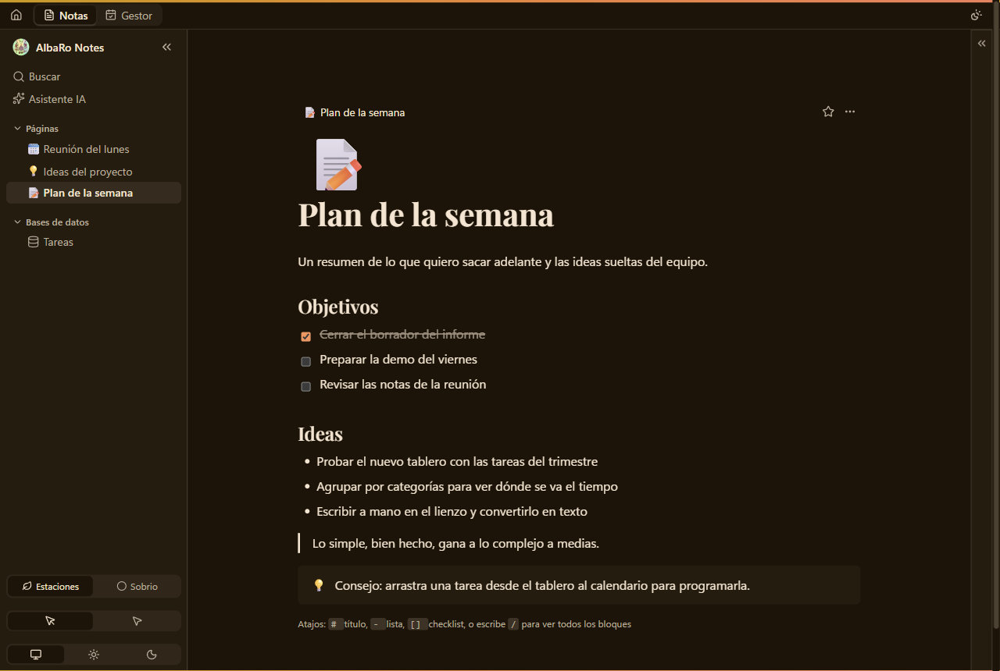
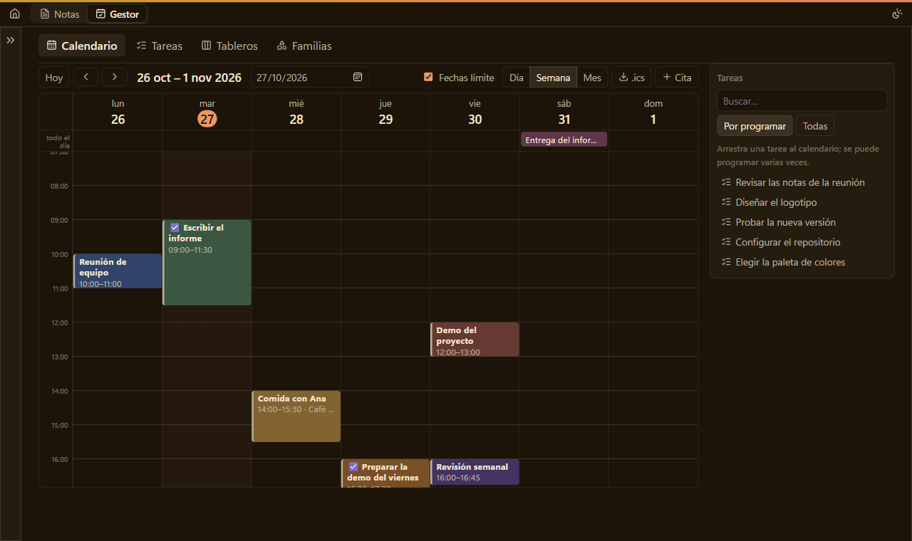
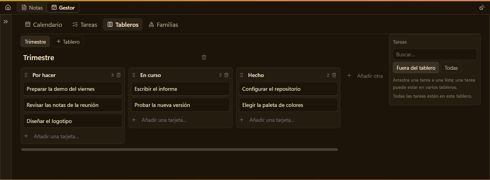

# AlbaRo Notes

[Español](README.es.md)

A free, open desktop app for notes and personal organisation: pages with a block editor, databases with many
kinds of views, a built-in task manager with calendar and boards, and an optional AI assistant. Everything is
stored on your computer, with no accounts, no ads and no telemetry.



The interface is currently in Spanish only.

## Features

- **Block editor**: headings, lists, checklists, quotes, callouts, toggles, columns, tabs, tables, code with syntax
  highlighting, equations, images, video, audio, files, web bookmarks and blocks synced between pages. Type `/` to
  insert any of them. Page icons and covers, a breadcrumb trail, favourites, `Ctrl+K` to search and run commands.
- **Databases**: a database is a page of its own, with typed properties (text, number, date and date range, select,
  multi-select, checkbox, relation, place) and as many saved views as you like: table, list, gallery, board,
  calendar, timeline, map, chart, dashboard and form. Filter, sort and group every view.
- **Personal manager**: a task list, a calendar (day, week and month, recurring events, export to `.ics`),
  Trello-style boards where a card is a reference to a task, and "families" that group tasks by what they have in
  common. Drag a task from any of them to the calendar or a board.
- **Handwriting canvas**: draw or write on an endless sheet, keep the ink as it is, or turn it into text or an image
  whenever you want.
- **Import** Markdown, Word and HTML files, or a whole folder, as pages.
- **Optional AI assistant**, off by default. Use it locally with [Ollama](https://ollama.com/), or online with your own
  key (Groq, Gemini and OpenRouter have free plans; Anthropic is paid). It searches your notes and writes in your
  pages, but it never changes your data by itself: every change is a proposal that you apply or discard.
- **Local first**: one SQLite database in your user folder. Light and dark themes, and a palette that follows the
  seasons of the year.





The screenshots show made-up data.

## Install

Download the installer from the [Releases page](https://github.com/AlbaRoDev/AlbaRo-Notes/releases).

| System        | File             | Status            |
| ------------- | ---------------- | ----------------- |
| Windows 10/11 | `.exe` installer | Main platform     |
| Linux         |                  | Not available yet |
| macOS         |                  | Not available yet |

**Windows and SmartScreen.** The installer is not code-signed yet, so Windows SmartScreen may show "Windows
protected your PC". If you downloaded it from the Releases page, choose _More info_ and then _Run anyway_. Each
release lists the SHA-256 checksum of its installer: compare it with the one of the file you downloaded
(`Get-FileHash <file>` in PowerShell) if you want to be sure it is untouched.

**Updates.** The app checks GitHub for a new version when it starts and every 12 hours. It only tells you: nothing
is downloaded or installed until you press the button, and the update's signature is checked against the project's
key first.

## Privacy

Your notes live in a SQLite database **on your computer**. There are no accounts, no telemetry and no server of ours.
The only things that leave your machine are the ones you turn on:

| What                                                                               | Where to                                                             | When                                                                                  |
| ---------------------------------------------------------------------------------- | -------------------------------------------------------------------- | ------------------------------------------------------------------------------------- |
| The text of the notes the AI reads or rewrites, and handwriting images you convert | The online service you chose (Groq, Gemini, OpenRouter or Anthropic) | Only with the AI in "online" mode, with your key **and** your consent. Off by default |
| Nothing (it stays on your computer)                                                | Ollama, on `127.0.0.1`                                               | With the AI in "local" mode                                                           |
| The address you type (the server sees your IP and that address, not your notes)    | That website                                                         | Only when you type an address in an image, video, audio, file or bookmark block       |
| Which parts of a map you look at                                                   | OpenStreetMap                                                        | When you view a map (tiles are cached)                                                |
| The place you search for                                                           | Nominatim (OpenStreetMap)                                            | Only when you press "Search" on a place                                               |
| Your IP, to see if there is a new version                                          | GitHub                                                               | At start and every 12 hours (nothing installs by itself)                              |
| The address of a link                                                              | Your browser                                                         | When you open it with Ctrl+click                                                      |

The AI service's API key is kept in the system credential store (Windows and macOS; on Linux, a file only you can
read) and the interface never reads it. Text you delete is really erased from the database file.

## Security

To report a problem see [SECURITY.md](SECURITY.md). In short: the page has no internet access, every command validates
its arguments again in Rust, the AI only proposes changes that you apply, and the CI checks dependencies and licences
on every push and every week.

## Development

Requirements: Node.js LTS, Rust (rustup) and the [Tauri 2 prerequisites](https://tauri.app/start/prerequisites/) for
your system. The package manager is **npm** (`package-lock.json`).

```bash
npm install
npm run tauri dev      # the app with hot reload
```

| Command                                                      | What it does                                                     |
| ------------------------------------------------------------ | ---------------------------------------------------------------- |
| `npm run lint`                                               | ESLint                                                           |
| `npm run format`                                             | Prettier                                                         |
| `npm test`                                                   | JavaScript tests (`tests/`)                                      |
| `npx tsc --noEmit`                                           | type check                                                       |
| `cargo test` (in `src-tauri/`)                               | Rust tests (database, validation, AI...)                         |
| `cargo fmt` / `cargo clippy --all-targets` (in `src-tauri/`) | Rust format and lint                                             |
| `npm run notices`                                            | regenerate `THIRD_PARTY_NOTICES.txt` after changing dependencies |
| `npm run tauri build`                                        | production installer                                             |

The app version lives in `package.json`, `src-tauri/Cargo.toml` and `src-tauri/tauri.conf.json`: bump it in all
three at once.

## License

[MIT](LICENSE). The licences of what the app includes are in [THIRD_PARTY_NOTICES.txt](THIRD_PARTY_NOTICES.txt),
generated with `npm run notices`.
